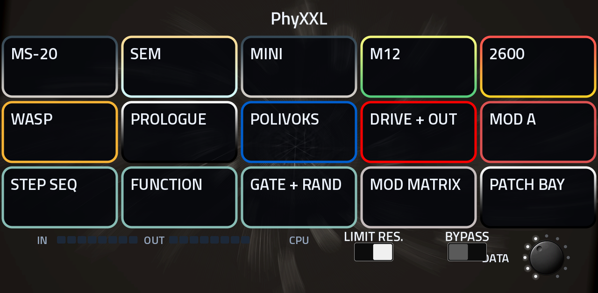
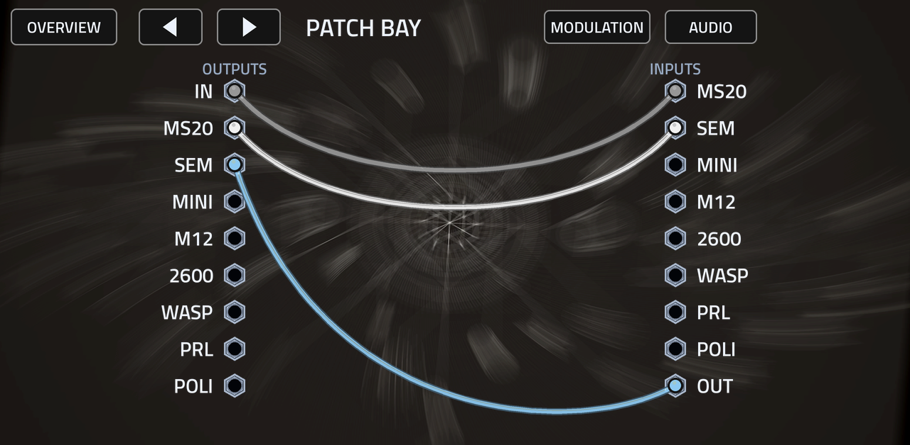

# PhyXXL

Eight classic synth filters in one **effect** plugin for the Akai Force / MPC OS (VST2, armv7), by L'Cronx.



**Filters:** MS-20 (HP + LP), SEM, Minimoog ladder, Matrix-12, ARP 2600 (4012 / 4072 / 4075), EDP Wasp, Korg prologue, Polivoks.
Each has its own page with its panel controls, mix / pan / output level and a small live response picture
(dots along the filter curve, a dot on the ruler at the cutoff).

**Audio routing:** the PATCH BAY / AUDIO page patches the plugin input and every filter's output into any filter's
input or the plugin output (series, parallel, split and merge; inputs sum; a loop is refused). The DRIVE + OUT page
has drive, low / high cut, width and dry / wet, with SERIES / PARALLEL / CLEAR shortcuts.

**Modulation:** ten sources (LFO, ENV, FOLLOWER, STEP, FUNCTION, GATE, RANDOM, MOD WHEEL, VELOCITY, KEY) to six
destinations of every filter (cutoff, resonance, drive, mode, pan, level), by touch: tap a source, tap an input, set
the amount (PATCH BAY / MODULATION), or in the MOD MATRIX. 28 factory patches carry their cables.



## Install

Download the zip from Releases and run `install.sh` (INSTALL.md inside), or use the MPC plugin installer.
Needs MPC OS 3.x (the skin uses features 2.x lacks).

## Build

```
pip install pillow numpy ziglang     # plus a host gcc
./build.sh                           # skin, params, plugin (armv7) -> build/package/
```

`tools/spec.py` is the single source of truth; `tools/gen_params.py` writes params, layout and inventory,
`tools/post_skin.py` draws the panel from the art in `art/src`. The framework is the `third_party/mpc-vst-plugins`
submodule.

## Honest status

* The DSP are my own models of these filters (circuit-inspired, not circuit-solved) and have **not been heard on a
  Force yet**. The armv7 binary is compiled and linked, not run. See TESTING.md.
* Approximate or guessed: 2600 type 4075; the Matrix-12 mode list (the modes are not named in my sources); the
  prologue and Polivoks envelope amount and decay controls; the follower is "after drive", not a true sidechain; MIX is
  stereo width (0..200 %).
* The skin carries about 4,800 cable pictures (about 78 MB decoded); if a Force runs short of memory, tell me.
* The response picture follows each filter's cutoff, resonance and mode with an analytic curve, not a measurement.

The filters are modelled in the style of well-known synth filters (the Korg MS-20 and prologue, Oberheim SEM and Matrix-12, Minimoog, ARP 2600, EDP Wasp, Polivoks). No code from any of them; not made or endorsed by their makers. GPL-3.0-or-later.
